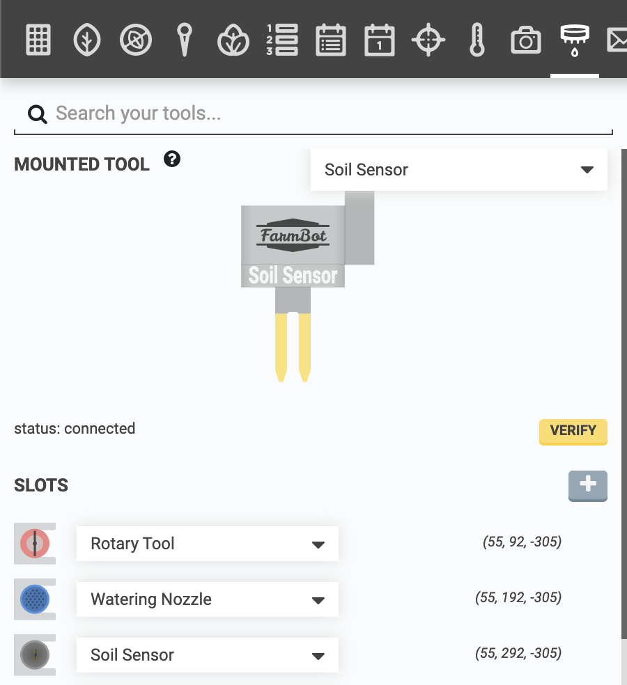
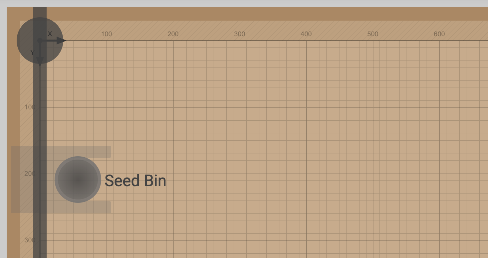
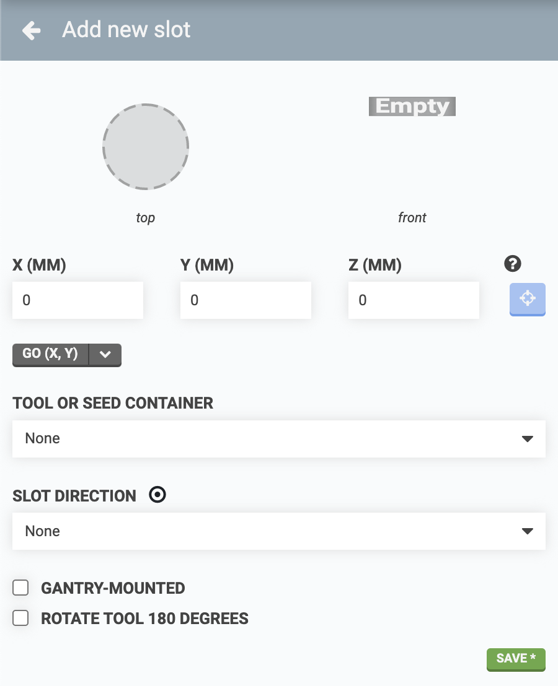
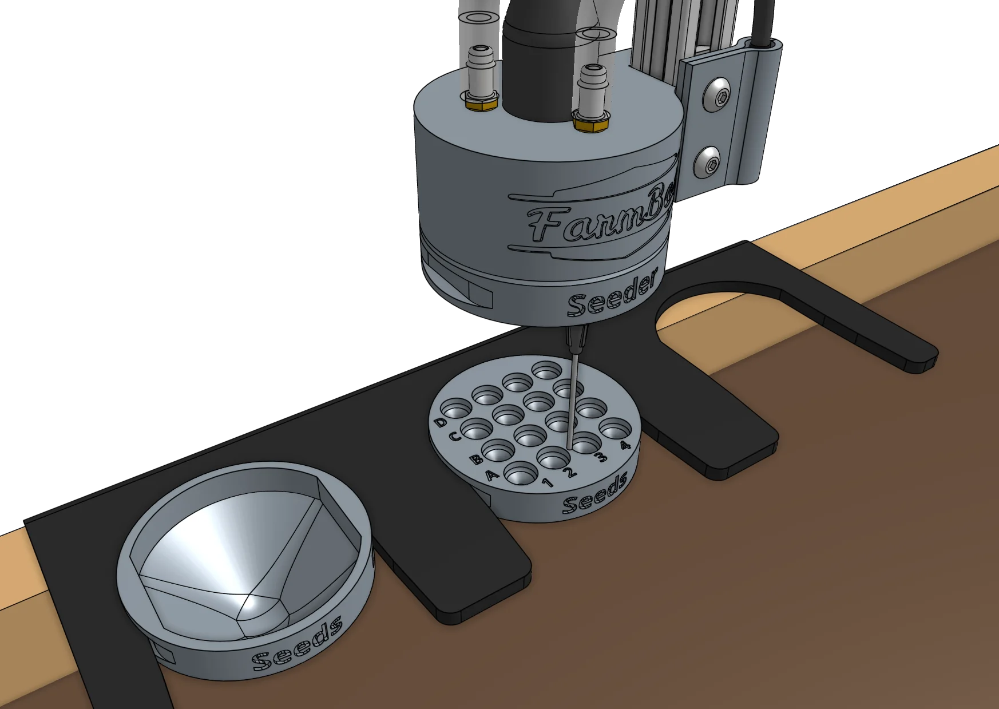
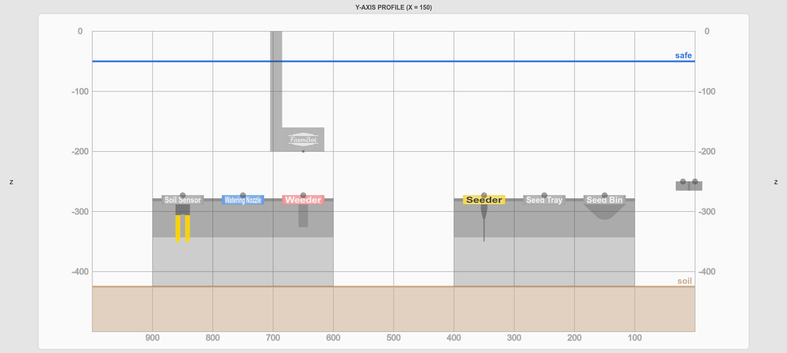
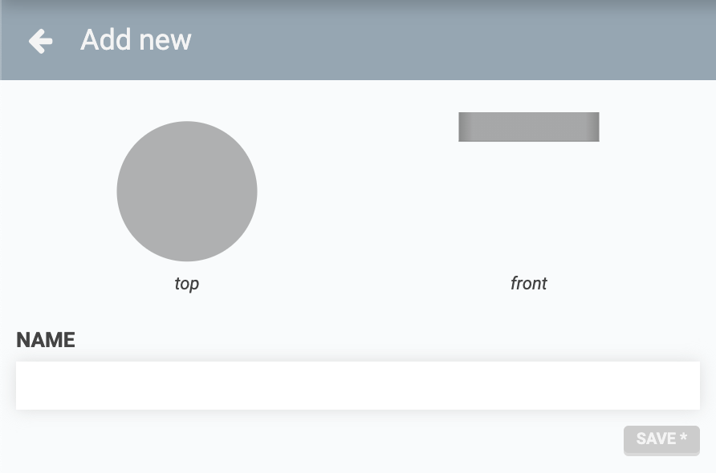

On the **tools panel** you can manage all of your FarmBot's **slots**, **tools**, and **seed containers** as well as view the currently mounted tool.



# Slots

**Slots** are locations within FarmBot's coordinate system that can hold a **tool** or **seed container** and correspond to physical hardware such as a toolbay (Genesis kits) or the gantry-mounted seed trough holder (all kits).

## Creating slots

To create a new slot, press the <i class='fa fa-plus'></i> button next to the **SLOTS** label in the tools panel.

Next, provide **coordinates** for the tool slot. To input accurate coordinates, use the manual controls to move FarmBot into the target position and then click the **USE CURRENT LOCATION** <i class='fa fa-crosshairs'></i> button to copy FarmBot's current coordinates into the **X**, **Y**, and **Z** input fields.

Different tools and seed containers will require different coordinates for the slot:

  * **Interchangeable tools** (Genesis kits only) - Use coordinates for when FarmBot's UTM will fully mount the tool while it is still in the slot.
  * **Seed bins** and **seed troughs** - Use coordinates for when FarmBot's seed injector needle will be positioned to pick up a seed from the container.
  * **Seed trays** (with 16 individual cells) - Use coordinates for when FarmBot's seed injector needle is positioned between cells **A2** and **A3**, approximately 1mm above the top of the seed tray. If your tool slot’s pullout direction is in the Negative X direction, position the needle exactly between cells **D2** and **D3**. In either case, the UTM’s main cylindrical section should be aligned with the outer cylindrical face of the seed tray as in the example image below. Then use the [Pick from Seed Tray](https://my.farm.bot/app/shared/sequence/32) featured sequence for picking up seeds from a specific cell in the tray.
  

### Changing slot direction

Some slots (such as the toolbays included with Genesis kits) have a **slot direction**, which is the direction that the tool must be loaded and unloaded from. To specify a slot's direction, use the **SLOT DIRECTION** dropdown.

### Axis-mounted slots

Some slots (such as those provided by the seed trough holder) are gantry-mounted and move with the FarmBot along the x-axis. To account for this and properly render these types of slots in the farm designer, you can specify that a slot's **MOUNT STAGE** is the x-axis using the dropdown. Doing so will display the **X** coordinate as X axis.

Choose **Stationary**, **X axis**, **Y axis**, or **Z axis** from the **MOUNT STAGE** dropdown. X-axis mounting follows X movement; Y-axis mounting follows X and Y; Z-axis mounting follows all three axes. Use **MOUNT OFFSET** to specify the slot's offset from FarmBot's current position on those axes. Each mounted coordinate is the current bot coordinate plus its mounting offset; unmounted coordinates use the stored slot coordinates.

## Loading slots

To load a tool or seed container into the slot, select one from the **TOOL OR SEED CONTAINER** dropdown and then press save.



## Deleting slots

To delete a slot, select it from the **SLOTS** list in the main tools panel and then press the DELETE button.



# Tools and seed containers

## Creating tools and seed containers

To create a new **tool** or **seed container**, press the <i class='fa fa-plus'></i> button. Provide a **NAME**, choose a **TYPE**, and then press SAVE. Alternatively, you can select from the available **STOCK NAMES** to add one or more of the standard tools and seed containers included with your FarmBot kit.

## Editing tools and seed containers

To edit a tool or seed container, click it from the **TOOLS AND SEED CONTAINERS** list (Genesis), or the **SEED CONTAINERS** list (Express) located at the bottom of the main tools panel. Make your desired edits and then press the SAVE button.

The following settings are available when creating or editing a tool or seed container:

* **TYPE** - Choose Rotary Tool, Seed Bin, Seed Tray, Seed Trough, Seeder, Soil Sensor, Watering Nozzle, Weeder, or None. The type determines the tool's standard graphics and available tool actions.
* **UTM MOUNTABLE** - Enable this for tools that can be mounted by the universal tool mount. Only tools with this setting enabled appear in the **MOUNTED TOOL** dropdown. Leave it disabled for seed containers.
* **EFFECTOR OFFSET** - Enter the X, Y, and Z offsets in millimeters from the tool head's reference position to the tool's working tip. An effector below the reference position has a negative Z offset; for example, a seeder tip 80mm below it has a Z offset of `-80`.
* **WATER FLOW RATE (ML/S)** - Available for tools with the **Watering Nozzle** type. Enter the measured flow rate used by dispensing sequences.

## Deleting tools and seed containers

To delete a tool or seed container, click it from the **TOOLS AND SEED CONTAINERS** list (Genesis), or the **SEED CONTAINERS** list (Express) located at the bottom of the main tools panel. Then click the DELETE button.



# What's next?

 * [Message Center](intro/message-center.md)
